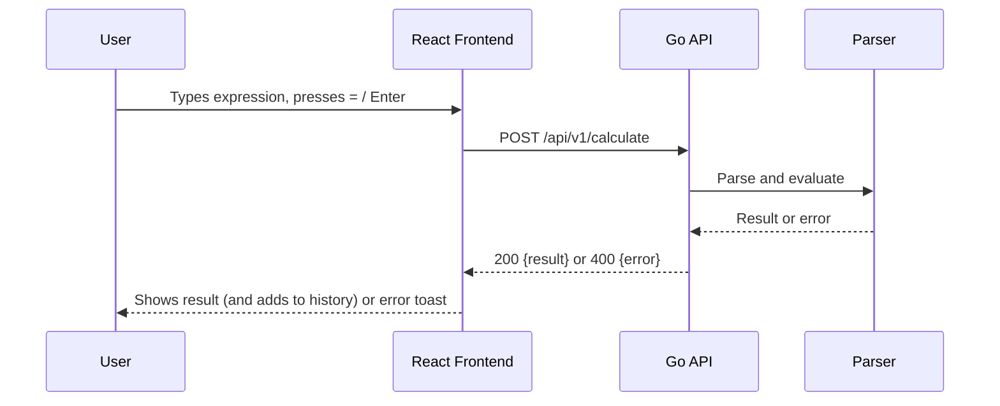

# Sezzle Full-Stack Calculator


A modern, production-ready full-stack calculator application featuring a **Go** REST microservice backend and a **React + TypeScript** frontend powered by Vite. The backend parses and evaluates full arithmetic expressions with a hand-written recursive descent parser; the frontend is a clean, typed client with history management and physical keyboard support.

---

## Table of Contents
- [Features](#features)
- [Quick Start](#quick-start)
  - [Prerequisites](#prerequisites)
  - [Option A: Run Locally](#option-a-run-locally)
  - [Option B: Docker Compose (Optional)](#option-b-docker-compose-optional)
- [Architecture & Design Decisions](#architecture--design-decisions)
- [Expression Grammar & Semantics](#expression-grammar--semantics)
- [API Reference](#api-reference)
- [Configuration](#configuration)
- [Testing](#testing)
- [Project Structure](#project-structure)
- [Limitations & Future Work](#limitations--future-work)
- [AI Usage](#ai-usage)
- [License](#license)

---

## Features

* **Basic operations**: Addition (`+`), subtraction (`−`), multiplication (`×`), division (`÷`).
* **Scientific operations**:
  * Parentheses `(` and `)` for sub-expression grouping.
  * Exponentiation `^` (right-associative power).
  * Square root `sqrt(...)`, validated for non-negative input.
  * Postfix percentage `%` (divides the preceding operand by 100).
* **Operator precedence**: Strict PEMDAS/BODMAS rules (multiplication and division strictly precede addition and subtraction).
* **History**: Tracks the last 8 calculations with click-to-reuse capability.
* **Error handling**: Division by zero, malformed syntax, unbalanced parentheses, and invalid domains return structured HTTP 400 responses, surfaced as non-blocking toasts in the UI.
* **Keyboard support**: Full physical keyboard listeners for digits `0-9`, operators `+`, `-`, `*`, `/`, `(`, `)`, `^`, `%`, `Enter` (evaluate), `Backspace`, and `Escape` (clear).

---

## Quick Start

### Prerequisites

| Tool | Version | Notes |
| :--- | :--- | :--- |
| **Go** | 1.22+ | Required for Option A (Backend) |
| **Node.js** | 18+ | Required for Option A (Frontend) |
| **Docker & Docker Compose** | Recent version | Only for Option B (optional) |

---

### Option A: Run Locally

Clone the repository and open the folder in VS Code. Its integrated terminal opens at the project root:

```bash
git clone <repository-url>
```

Then start the two services in separate terminals.

**1. Backend (Go)**

```bash
cd Backend
go run main.go
```

The API will start listening on http://localhost:8080.

**2. Frontend (React + TypeScript)**

In a separate terminal tab:

```bash
cd Frontend
npm install
npm run dev
```

Open http://localhost:5173 in your browser.

### Option B: Docker Compose (Optional)

To build and run both services concurrently in isolated containers:

```bash
docker compose up --build
```

| Service | URL | Notes |
| :--- | :--- | :--- |
| Frontend | http://localhost:5173 | Served via Nginx (port 80 inside container) |
| Backend API | http://localhost:8080 | Go REST microservice |
| Health Check | http://localhost:8080/health | Service uptime check |

---

## Architecture & Design Decisions

### Backend: Go Standard Library Microservice

* **Standard Library (`net/http`)**: Built without third-party web frameworks (such as Gin or Echo). For a microservice with focused endpoints, the standard library minimizes external dependency risk, ensures zero security bloat, and compiles into a single lean static binary.
* **Recursive Descent Parser (`calculator/calculator.go`)**: Each precedence level is mapped to a dedicated function. This makes operator precedence, associativity, and error boundaries easy to reason about and test, completely avoiding unsafe string evaluation (`eval`) or third-party parsing dependencies.
* **Server-Side Evaluation**: Centralizing the math engine in the Go microservice provides a single source of truth, allows comprehensive unit testing in isolation, and keeps the frontend lightweight. The trade-off is one network round trip per calculation.
* **Structured Errors**: Every input and evaluation failure maps to an HTTP `400 Bad Request` response with a `{ "error": "..." }` JSON body. Requests with an unsupported HTTP method receive a standard `405 Method Not Allowed` with an `Allow: POST` header.

### Request Flow



### Frontend: React + TypeScript + Vite

* **Type Safety**: Strictly typed interfaces for all API payloads and calculator state models (`services/api.ts`).
* **Continuous Multi-Operation Input**: Allows entering complex mathematical expressions before triggering server evaluation with `=` or `Enter`.
* **Ergonomic History Drawer**: Maintained in client memory and strictly capped at 8 entries to preserve visual balance.
* **Non-blocking Error Handling**: Interactive error toast notifications when server-side business rules are violated.

---

## Expression Grammar & Semantics

```text
expr     → term (('+' | '-') term)*
term     → factor (('*' | '/') factor)*
factor   → power ('^' factor)?          // right-associative power
power    → ('+' | '-') power | primary
primary  → ( NUMBER | '(' expr ')' | 'sqrt' '(' expr ')' ) '%'*
```

**Semantics & Precedence Details**

* **Right-associativity**: `2 ^ 3 ^ 2` = `2 ^ (3 ^ 2)` = `512`.
* **Postfix percentage**: `%` is an immediate postfix operator dividing by 100: `5 × 6%` = `0.3`, and `50 + 10%` = `50.1`.
* **Unary minus binds tighter than `^`**: `-2 ^ 2` = `(-2) ^ 2` = `4`, and `2 ^ -1` = `0.5`. Use parentheses, e.g. `-(2 ^ 2)`, to get `-4`.
* **Stacked percentages**: `%` can be chained, so `5%%` = `0.0005`.
* **Domain validation**: Negative square roots (`sqrt(-4)`) are explicitly rejected as undefined for real numbers.
* **Floating-point standard**: Computations use standard IEEE-754 64-bit floating-point arithmetic (`float64`).

---

## API Reference

**Base URL:** `http://localhost:8080`

### 1. Calculate Expression

**Endpoint:** `POST /api/v1/calculate`

**Headers:** `Content-Type: application/json`

**Request:**

```bash
curl -X POST http://localhost:8080/api/v1/calculate \
  -H "Content-Type: application/json" \
  -d '{"expression": "(3 + 2) * 4 - 6 / 2"}'
```

**Response (200 OK):**

```json
{
  "result": 17,
  "expression": "(3 + 2) * 4 - 6 / 2"
}
```

**Error Handling Examples:**

| Error Case | Example Payload | Status Code | Error Message |
| :--- | :--- | :---: | :--- |
| Division by zero | `{"expression": "10 / 0"}` | 400 | `"division by zero is not allowed"` |
| Negative square root | `{"expression": "sqrt(-4)"}` | 400 | `"square root of negative number is not defined for real numbers"` |
| Unbalanced parentheses | `{"expression": "(2 + 3"}` | 400 | `"mismatched or unclosed parentheses"` |
| Malformed syntax | `{"expression": "2 + * 3"}` | 400 | `"invalid mathematical expression"` |
| Empty expression | `{"expression": ""}` | 400 | `"expression cannot be empty"` |
| Invalid JSON body | `{bad json` | 400 | `"invalid request body"` |
| Wrong HTTP method | `GET /api/v1/calculate` | 405 | `Method Not Allowed` (plain text, with an `Allow: POST` header) |

### 2. Service Health Check

**Endpoint:** `GET /health`

```bash
curl -X GET http://localhost:8080/health
```

**Response (200 OK):**

```json
{
  "status": "healthy"
}
```

---

## Configuration

| Environment Variable | Component | Default | Description |
| :--- | :--- | :--- | :--- |
| `PORT` | Backend | `8080` | HTTP port for the Go server |
| `VITE_API_BASE_URL` | Frontend | `http://localhost:8080` | Base URL of the backend microservice |

---

## Testing

### Backend Tests (Go)

```bash
cd Backend
go test -cover ./...
```

**Coverage:** `calculator` package (84.1%), `handlers` package (77.4%).

Uses idiomatic table-driven unit tests covering operator precedence, associativity, nested parentheses, domain validation, division by zero, and HTTP mock recorders (`net/http/httptest`).

### Frontend Tests (Vitest + React Testing Library)

```bash
cd Frontend
npm test
```

**Test Suite:** 7 / 7 passing.

Covers component mounting, expression building, physical keyboard events, history toggle, successful API mocking, and error toast rendering.

---

## Project Structure

```text
sezzle-calculator/
├── Backend/
│   ├── calculator/
│   │   ├── calculator.go         # Recursive descent parser & evaluator
│   │   └── calculator_test.go    # Table-driven unit tests
│   ├── handlers/
│   │   ├── handler.go            # HTTP controllers & CORS middleware
│   │   └── handler_test.go       # HTTP endpoint integration tests
│   ├── main.go                   # HTTP server entrypoint
│   ├── go.mod                    # Go module definition
│   └── Dockerfile                # Multi-stage container build
├── Frontend/
│   ├── src/
│   │   ├── services/
│   │   │   └── api.ts            # Typed HTTP API client
│   │   ├── App.tsx               # Calculator UI logic & state
│   │   ├── App.css               # Glassmorphic fintech styles
│   │   ├── App.test.tsx          # Vitest & RTL component tests
│   │   └── setupTests.ts         # Jest-DOM matchers
│   ├── package.json
│   ├── vite.config.ts            # Vite & Vitest configuration
│   └── Dockerfile                # Multi-stage Nginx container build
├── docker-compose.yml            # Multi-service local orchestrator
├── .gitignore
└── README.md
```

---

## Limitations & Future Work

### Current Architectural Trade-offs

* **In-Memory History**: Calculation history is maintained in client state during the active session.
* **Precision**: Computations rely on IEEE-754 64-bit floating-point numbers (`float64`).

### Future Roadmap

* **Persistent History**: Integrating local storage or a backend database for session persistence across page reloads.
* **Arbitrary Precision**: Supporting arbitrary-precision decimals (e.g. `shopspring/decimal` in Go) for high-precision financial accounting.
* **CI/CD Integration**: GitHub Actions workflow running both Go and Vitest test suites on pull requests and pushes.
* **Rate Limiting**: Middleware token bucket algorithm to protect endpoints against automated request abuse.

---

## AI Usage

AI tools were used during development. A selection of the prompts I used is documented in [PROMPTS.md](PROMPTS.md).

---

